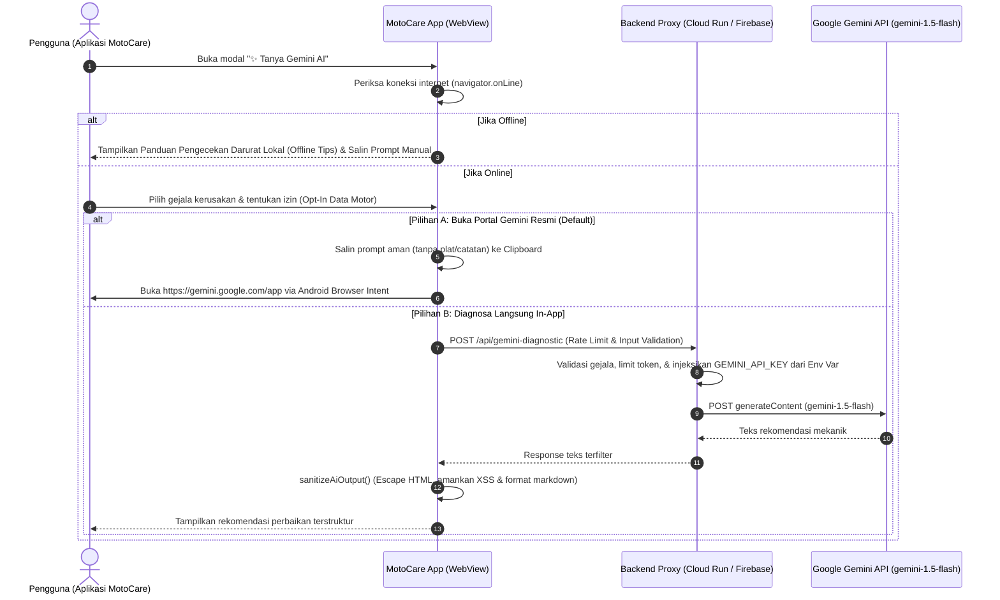

# 🛵 MotoCare — Aplikasi Perawatan & Monitoring Motor Roda Dua Indonesia

Aplikasi Android khusus kendaraan roda dua untuk masyarakat Indonesia: memantau konsumsi BBM (rasio km/L), menjadwalkan servis berkala 15 komponen, pengingat pajak STNK, pemeriksaan fisik live kamera, pintasan diagnosa Gemini AI, dan notifikasi layar HP.

---

## 📥 Download Aplikasi & Distribusi APK (Releases)

File binary APK didistribusikan secara resmi melalui **[GitHub Releases](https://github.com/syifaulmu/motocare/releases)** dan **GitHub Actions Artifacts**. Berkas binary sengaja **tidak disimpan di dalam source control git** (`.gitignore`) demi menjaga kebersihan riwayat commit, mencegah pembengkakan ukuran repo (*repo bloat*), dan mematuhi *best practices* rekayasa perangkat lunak modern.

| Versi | Status | Sumber Unduhan |
|---|---|---|
| **MotoCare v2.0 Release** | ✅ Rilis Resmi (Signed) | [**Download via GitHub Releases**](https://github.com/syifaulmu/motocare/releases) |
| **CI Debug Build** | 🧪 Automated Build | Tab [**Actions**](https://github.com/syifaulmu/motocare/actions) (unduh APK dari artifact run) |

> **Cara Pasang di HP Android:**
> 1. Unduh file APK versi terbaru dari halaman [GitHub Releases](https://github.com/syifaulmu/motocare/releases).
> 2. Buka notifikasi atau pengelola berkas di HP Anda, lalu pilih **Install**.
> 3. Jika muncul konfirmasi *"Izinkan instalasi dari sumber tidak dikenal"*, aktifkan izin untuk browser/file manager Anda.

### 📦 Panduan Distribusi Rilis Baru (Bagi Maintainer)
1. Buat tag rilis baru di git: `git tag -a v2.0.0 -m "Release v2.0.0"`
2. Buka halaman **GitHub Releases** > **Draft a new release**.
3. Pilih tag `v2.0.0`, lampirkan *changelog* perbaikan, dan unggah file `app-release.apk` atau unduh file `app-debug.apk` dari artifact tab GitHub Actions.
4. Publikasikan rilis (*Publish Release*).

---

## 🏗️ Arsitektur Aplikasi (Architecture Overview)

MotoCare dibangun dengan arsitektur hibrida modern yang memisahkan tanggung jawab antarmuka, logika bisnis murni, persistensi, dan layanan sistem native Android:

```mermaid
graph TD
    subgraph Native Android Layer (Java)
        MA["MainActivity (WebView Container)"]
        WM["WorkManager (PeriodicReminderWorker)"]
        AM["AlarmManager (NotificationScheduler)"]
        BR["BootReceiver (Reboot Resilience)"]
    end

    subgraph Core Logic & Storage
        ML["MotoLogic (assets/moto_logic.js)"]
        STG["StorageManager (IndexedDB + localStorage Fallback)"]
        STR["MotoCare.Store (Central State)"]
        EB["MotoCare.EventBus (Pub/Sub Observer)"]
    end

    subgraph UI Modules (Single Responsibility)
        APP["MotoCare.App (Bootstrap)"]
        RND["MotoCare.Render (DOM Master)"]
        FL["MotoCare.Fuel (BBM)"]
        SV["MotoCare.Service (15 Komponen)"]
        WZ["MotoCare.Wizard (Tambah Motor)"]
        NT["MotoCare.Notifications (Bridge)"]
        CAM["MotoCare.Camera (Live Check)"]
        GEM["MotoCare.Gemini (AI Diagnostic)"]
    end

    MA <-->|"@JavascriptInterface (JS Bridge)"| NT
    MA -->|"Hosts file:///android_asset/"| APP
    WM -->|"Doze-resilient periodic check"| AM
    BR -->|"Restores on boot"| WM

    STG --> STR
    EB <--> STR

    STR --> RND
    STR --> FL
    STR --> SV
    STR --> WZ
    STR --> NT

    ML --> FL
    ML --> SV
    ML --> WZ
    ML --> NT
    ML --> RND

    EB -.->|"Fine-grained Events"| RND
    EB -.->|"Fine-grained Events"| SV
    EB -.->|"Fine-grained Events"| FL
```

### Karakteristik Arsitektur Utama:
- **Modular IIFE Namespace**: Seluruh modul front-end (`assets/modules/`) ditulis dengan kontrak Dependency Injection tanpa variabel global liar, dibundel secara otomatis oleh `scripts/build_bundle.js`.
- **Observer / EventBus Terpusat**: Perubahan state memancarkan event spesifik (`ODOMETER_UPDATED`, `FUEL_ADDED`, `COMPONENT_REPLACED`), sehingga antarmuka hanya merender komponen yang relevan tanpa pemanggilan `renderAll()` berulang yang boros performa.
- **Pure Logic Independence (`moto_logic.js`)**: Logika murni (perhitungan km/L, interval servis, evaluasi jatuh tempo pajak, dan validasi input) terpisah 100% dari manipulasi DOM, berformat UMD sehingga dapat diuji secara mandiri dengan Node.js/Vitest.

---

## 💾 Persistensi & Migrasi Data (Data Storage & Migration)

MotoCare menjamin prinsip **Offline-First Data Durability** dan integritas data pengguna antar-versi:

### 1. Lapisan Abstraksi Penyimpanan (Storage Abstraction)
- **IndexedDB (`MotoCareDB`)**: Penyimpanan utama untuk data terstruktur (`motors`, `fuelLogs`, `serviceLogs`, `checklistStates`). Berjalan secara asinkron tanpa batasan kuota sempit localStorage (5 MB).
- **LocalStorage Fallback**: Jika peramban atau WebView lama tidak mendukung IndexedDB, sistem secara transparan beralih ke `localStorage` melalui API seragam `StorageManager`.

### 2. Mekanisme Migrasi Skema Berversi (`schemaVersion`)
- Data internal memiliki penanda versi skema (`schemaVersion: 1`).
- **Migrasi Otomatis Tanpa Kehilangan Data**: Saat aplikasi dimuat pertama kali, `StorageManager.migrateLegacyLocalStorage()` mendeteksi data lama dari kunci `motocare_v2_store`, menjalankan fungsi transformasi `applyMigrations()`, memindahkan data ke IndexedDB, dan menandai flag `motocare_migrated_v1`.
- **Idempotensi Penuh**: Fungsi migrasi dapat dijalankan berulang tanpa memicu duplikasi ID motor, log servis, atau bensin.

### 3. Pencadangan & Pemulihan Data (Backup & Restore JSON)
- **Ekspor Data**: Menghasilkan berkas `motocare_backup_YYYY-MM-DD.json` berstruktur standar dengan metadata aplikasi (`app`, `version`, `schemaVersion`, `exportedAt`, `data`). Terintegrasi dengan fitur berbagi Android (`Intent.ACTION_SEND`) dan download berkas lokal.
- **Validasi Impor Ketat**: Memvalidasi integritas JSON, keberadaan array `motors`, kelengkapan ID unik, merek, dan model. Berkas yang rusak atau tidak sesuai skema ditolak dengan pesan error yang ramah pengguna.

---

## 🌟 Fitur Unggulan Versi 2.0

- 🛵 **Default Awal Bersih**: Siap digunakan langsung oleh masyarakat umum. Cukup tap tombol *"Tambah Motor"* untuk mendaftarkan motor pertama Anda.
- 📚 **34+ Database Motor Populer Indonesia**:
  - **Honda Matic**: BeAT eSP, BeAT Street, Scoopy, Vario 110, Vario 125, Vario 160, ADV 160, PCX 160, Genio.
  - **Yamaha Matic**: Mio M3, Mio S, Gear 125, NMAX 155 (Gen 1 Old, Gen 2, Gen 3 2024), Aerox 155, Fazzio, FreeGo.
  - **Honda Sport/Bebek/Trail**: Supra GTR 150, CB150R Streetfire, CB150 Verza, CRF150L, XL150 Dax.
  - **Yamaha Sport/Bebek**: MX King 150, XSR 155, WR155R, R15 V3.
  - **Suzuki & Kawasaki**: Address, Nex II, Burgman Street 125, KLX 150, W175.
  - **Motor Kustom**: Template fleksibel untuk sepeda motor merek apa pun.
- 🎨 **Desain Halus Retro-Automotive & Tema Ganda**:
  - 🌙 **Tema Gelap (Retro Noir Amber)**: Nuansa instrumen speedometer malam hari.
  - ☀️ **Tema Terang (Classic Vintage Cream)**: Tampilan krem hangat yang ramah di bawah terik matahari.
- ⛽ **Pencatatan BBM & Rasio Konsumsi (km/L)**:
  - Metode *full-to-full* akurat.
  - Pilihan 11 jenis bahan bakar di Indonesia (Pertalite, Pertamax, Turbo, Shell, BP, Vivo).
- 🔧 **Pemantauan 15 Komponen Servis Pintar**:
  - Dinamis menyesuaikan jenis motor (motor matic memantau V-Belt/Roller/Oli Gardan; motor sport/bebek memantau pelumasan & setelan rantai).
  - Algoritma **Estimasi Siklus Ideal Pabrikan** untuk motor second / tanpa data awal.
- 📹 **Cek Fisik Kamera Live**: Pemeriksaan kasat mata dengan retikel panduan visual (ban, rembesan oli, rantai/belt, suspensi).
- ✨ **Pintasan Gemini AI Diagnostik**: Menganalisis gejala kerusakan motor dengan generator prompt otomatis sesuai metadata motor Anda.
- 🔔 **Notifikasi Layar HP**: Pengingat persiapan jarak ideal (oli mesin sisa 350 km, V-belt sisa 2.000 km, pajak H-30/14/7) serta peringatan harian jika melewati batas aman (dapat diaktifkan/dinonaktifkan).

---

## 🤖 Integrasi Gemini AI Diagnostik & Kebijakan Privasi (Zero-Secret Architecture)

Fitur **Gemini AI Diagnostik** dirancang untuk membantu pemilik sepeda motor menganalisa gejala kerusakan teknis dengan tetap mengedepankan **keamanan rahasia API**, **privasi pengguna (Zero PII)**, dan **ketahanan offline**:



### 1. Prinsip Zero-Secret (Tidak Ada API Key di APK)
- **Larangan Keras**: `GEMINI_API_KEY` tidak pernah disimpan di dalam berkas JavaScript, Java, AndroidManifest, atau repositori git.
- **Backend Proxy Aman**: Panggilan API ditengahi oleh server proxy referensi ([server/gemini_proxy.js](server/gemini_proxy.js)) yang berjalan di lingkungan aman (Google Cloud Run / Firebase Cloud Functions / Vercel Serverless) yang membaca kunci rahasia secara eksklusif dari `process.env.GEMINI_API_KEY`.
- **Rate Limiting**: Proxy membatasi maksimal 10 permintaan per 15 menit per alamat IP untuk mencegah penyalahgunaan kuota atau serangan DoS.

### 2. Perlindungan Privasi & Mekanisme Opt-In Pengguna (Zero PII)
- **Persetujuan Eksplisit (*Opt-In Consent*)**: Tersedia kotak centang persetujuan: *"Sertakan data umum motor (Merek, Model, Tahun, Odo) untuk diagnosa akurat"*. Jika dinonaktifkan (*opt-out*), prompt diagnosa yang dihasilkan hanya berisi keluhan teknis umum tanpa metadata kendaraan.
- **Jaminan Anti-PII**: Nomor plat polisi (`plateNumber`), nomor rangka mesin, dan catatan pribadi pengguna **dikecualikan 100% secara permanen** dari prompt maupun payload jaringan.

### 3. Sanitasi Output AI Sebelum Dirender (Anti-XSS)
- Respon teks dari model LLM tidak pernah dirender langsung menggunakan `innerHTML`.
- Fungsi `sanitizeAiOutput()` membersihkan entitas HTML mentah (`<script>`, ``, `<iframe>`), kemudian mengubah format markdown tebal (`**teks**`) dan daftar poin (*bullet points*) secara aman ke elemen DOM terstruktur.

### 4. Resiliensi & Fallback Offline
- Saat ponsel offline, aplikasi mendeteksi event `offline` dan otomatis menampilkan **Panduan Pengecekan Cepat Lokal** (*offline diagnostic emergency tips*) untuk keluhan yang dipilih:
  - *CVT Gredek*: Panduan pembersihan debu kampas ganda, pengecekan keausan roller, dan retakan v-belt.
  - *Tarikan Berat*: Pengecekan busi berkerak, kondisi filter udara, dan tekanan ban.
  - *Rem Berdecit*: Pengecekan ketebalan kampas rem (< 1.5 mm) dan level minyak rem.
  - *Knalpot Asap*: Peringatan darurat level oli mesin (tongkat dipstick) dan indikasi ring piston aus.
  - *Motor Second*: Checklist segitiga setang, suara rantai keteng, dan rembesan paking blok silinder.
- Pengguna tetap dapat menyalin prompt ke clipboard untuk ditanyakan ke Gemini melalui perangkat lain atau saat koneksi internet kembali pulih.

### 5. Estimasi Biaya & Alur Gemini API (gemini-1.5-flash)
- **Model**: `gemini-1.5-flash` (model rekomendasi untuk respon super cepat dan hemat biaya).
- **Free Tier (Gratis)**: 15 RPM (*Requests Per Minute*), 1.500 RPD (*Requests Per Day*), dan 1 juta TPM (*Tokens Per Minute*) — **100% gratis** untuk skala komunitas.
- **Pay-as-you-go (Berbayar)**:
  - Input tokens: \$0.075 per 1.000.000 tokens (~Rp 1.200 per 1.000 diagnosa).
  - Output tokens: \$0.30 per 1.000.000 tokens (~Rp 2.400 per 1.000 diagnosa).
  - Rata-rata biaya per 1.000 konsultasi lengkap berkisar antara **Rp 3.600 - Rp 5.000** (sangat ekonomis).

---

## 🔒 Model Keamanan WebView (WebView Security & Threat Model)

Aplikasi MotoCare mengadopsi prinsip **Defense-in-Depth** dan **Least Privilege** untuk menjamin keamanan saat menjalankan konten web lokal di dalam WebView native Android:

1. **Isolasi Aset Offline & Pembatasan File System (Sandboxing)**:
   - `setAllowFileAccess(false)` & `setAllowContentAccess(false)`: Menonaktifkan akses langsung ke filesystem perangkat (`file:///sdcard/`, storage internal) dan Content Provider. File aset aplikasi tetap dapat diakses secara aman dan offline via `file:///android_asset/index.html`.
   - `setAllowFileAccessFromFileURLs(false)` & `setAllowUniversalAccessFromFileURLs(false)`: Mencegah serangan *cross-origin file traversal* atau pembacaan berkas lokal sembarangan antar-URL file.
   - `setMixedContentMode(MIXED_CONTENT_NEVER_ALLOW)`: Memastikan tidak ada konten HTTP tidak aman yang dapat dimuat.

2. **Validasi Origin & Pembatasan Resource Izin Perangkat**:
   - `WebChromeClient.onPermissionRequest` hanya memproses permintaan izin dari origin lokal terpercaya (`file://`, `localhost`, `appassets.androidplatform.net`).
   - Sumber daya perangkat dibatasi secara eksklusif hanya untuk `RESOURCE_VIDEO_CAPTURE` (kamera) demi fitur pemeriksaan fisik visual. Permintaan audio, mikrofon, atau resource lain otomatis ditolak (`deny()`).

3. **Validasi Ketat JS Bridge (`@JavascriptInterface`)**:
   - Semua input parameter dari JavaScript divalidasi tipe data, panjang maksimal, dan batas nilainya sebelum diproses:
     - `showToast`: Dibatasi maksimal 200 karakter, pembersihan karakter kontrol/newline (`\r`, `\n`, `\t`).
     - `vibrate`: Dibatasi durasi aman antara `10 ms` hingga `1.000 ms` untuk mencegah eksploitasi getaran terus-menerus yang menguras baterai atau merusak hardware vibrator.
     - `showSystemNotification` & `scheduleDailyOverdueAlarm`: Validasi judul (maks 100 karakter, *single-line*), pesan (maks 500 karakter), serta pembatasan ID notifikasi numerik positif (`1` s/d `999.999`).
     - `shareText` & `copyToClipboard`: Sanitasi teks dan pembatasan maksimal 50.000 karakter guna mencegah *Denial of Service* (DoS) akibat kehabisan memori buffer Android Binder (`TransactionTooLargeException`).
     - `openGeminiWithPrompt`: Prompt dibatasi maksimal 4.000 karakter dan URL navigasi dikunci secara absolut ke endpoint resmi (`https://gemini.google.com/app`). Script di WebView tidak memiliki kemampuan untuk membelokkan navigasi intent ke URL pihak ketiga atau skema privat.

4. **Penanganan Navigasi Intent Eksternal Aman**:
   - `WebViewClient.shouldOverrideUrlLoading` memblokir semua skema berbahaya (`javascript:`, `data:`, `content:`, `intent:`, `file:` di luar aset).
   - Tautan eksternal hanya diizinkan untuk protokol `http` dan `https`, dan diluncurkan ke browser sistem terpisah menggunakan `Intent.CATEGORY_BROWSABLE` dan proteksi `try-catch` dari `ActivityNotFoundException` maupun `SecurityException`.

---

## 🧪 Testing, Code Quality & CI/CD

MotoCare dilengkapi pengujian unit otomatis, linting kode ketat, dan pipeline CI/CD menggunakan GitHub Actions:

### 1. Menjalankan Unit Tests (Vitest)
Unit test mencakup 100% fungsi murni pada `moto_logic.js` (perhitungan BBM km/L, interval servis 15 komponen, status pajak STNK, dan validasi input), sanitasi XSS (`escapeHtml`), migrasi skema penyimpanan berversi (`StorageManager`), reaktivitas state store & event bus, serta sanitasi AI output & perlindungan privasi PII:

```bash
# Menjalankan seluruh test suite (114 tests)
npm test

# Menjalankan test dengan laporan code coverage (Target >= 80%)
npm run test:coverage
```

### 2. Linting & Formatter (ESLint & Prettier)
```bash
# Pengecekan kode dengan ESLint
npm run lint

# Memeriksa format kode dengan Prettier
npm run format:check

# Merapikan format kode secara otomatis
npm run format
```

### 3. Continuous Integration (GitHub Actions)
Pipeline `.github/workflows/ci.yml` secara otomatis berjalan pada setiap `push` dan `pull_request` ke branch `main`:
- **Lint & Unit Tests**: Menjalankan ESLint dan Vitest coverage (gagal jika ada lint error atau coverage di bawah 80%).
- **Build Debug APK**: Meng-compile APK Android dengan JDK 17 & Gradle 8.9, kemudian mengunggah file `app-debug.apk` sebagai artifact aksi CI tanpa mencemari riwayat commit git.

---

## 🔔 Ketahanan Notifikasi (WorkManager, Doze Mode & Reboot)

MotoCare menggunakan arsitektur notifikasi berlapis (*multi-tiered notification architecture*) untuk memastikan keandalan pengingat di lingkungan Android modern (Android 8.0 s/d Android 14+):

1. **Pengingat Periodik (Servis & Pajak) — WorkManager**:
   - Dijadwalkan menggunakan `PeriodicWorkRequest` (siklus 24 jam) dengan kebijakan `ExistingPeriodicWorkPolicy.KEEP`.
   - **Tahan Doze Mode**: Bekerja selaras dengan *maintenance window* sistem Android tanpa menguras baterai.
   - **Tahan Reboot**: Terjadwal ulang secara otomatis oleh database internal WorkManager setelah perangkat menyala kembali.
   - **Anti-Duplikasi**: Dilengkapi validasi tanggal kalender (`yyyy-MM-dd`) di `SharedPreferences` untuk mencegah spam notifikasi ganda pada hari yang sama.

2. **Alarm Kritis — AlarmManager dengan Graceful Fallback**:
   - Digunakan untuk pengingat harian yang mendekati jatuh tempo mendesak (*overdue* oli/pajak).
   - Memeriksa izin `canScheduleExactAlarms()` pada Android 12+ (API 31+).
   - Jika izin alarm exact ditolak atau dicabut oleh sistem, sistem secara mulus beralih ke `setAndAllowWhileIdle()` tanpa *SecurityException* atau crash.

3. **Pemulihan Pasca-Reboot — BootReceiver**:
   - Mendengarkan `ACTION_BOOT_COMPLETED` dan `ACTION_MY_PACKAGE_REPLACED`.
   - Memastikan WorkManager aktif dan menjadwalkan ulang alarm kritis yang waktunya masih di masa mendatang atau memicu notifikasi jika terlewat saat perangkat mati.

### 🧪 Panduan Uji Manual via ADB

#### 1. Uji Simulasi Kondisi Doze Mode
Untuk memverifikasi apakah notifikasi tetap berjalan atau tertunda secara wajar saat HP masuk mode hemat daya ekstrim (*Doze*):
```bash
# Cabut kabel daya virtual (simulasi baterai)
adb shell dumpsys battery unplug

# Paksa perangkat masuk ke mode Doze (idle)
adb shell dumpsys deviceidle force-idle

# Cek status idle (harus menunjukkan IDLE)
adb shell dumpsys deviceidle get deep

# Picu langkah maintenance window
adb shell dumpsys deviceidle step

# Kembalikan kondisi baterai normal setelah pengujian
adb shell dumpsys battery reset
```

#### 2. Uji Penjadwalan Ulang Pasca-Reboot
Untuk menguji apakah `BootReceiver` berhasil memulihkan jadwal tanpa perlu menyalakan ulang HP secara fisik:
```bash
adb shell am broadcast -a android.intent.action.BOOT_COMPLETED -p com.motocare.app
```
Periksa logcat:
```bash
adb logcat -s MotoCareBootReceiver:D MotoCareScheduler:D
```
*Output yang diharapkan:*
`MotoCareBootReceiver: Device broadcast received: android.intent.action.BOOT_COMPLETED`
`MotoCareScheduler: WorkManager periodic reminder scheduled with KEEP policy.`
`MotoCareBootReceiver: Boot restoration completed successfully.`

#### 3. Uji Eksekusi Paksa WorkManager
Untuk menguji worker pengingat tanpa menunggu siklus 24 jam:
```bash
# Cari Job ID WorkManager untuk com.motocare.app
adb shell dumpsys jobscheduler | grep -B 2 -A 5 "com.motocare.app"

# Jalankan job secara paksa (ganti <JOB_ID> dengan id yang ditemukan)
adb shell cmd jobscheduler run -f com.motocare.app <JOB_ID>
```

#### 4. Memantau Logcat Terstruktur
Untuk mengawasi seluruh aktivitas notifikasi:
```bash
adb logcat -v time -s MotoCarePeriodicWorker MotoCareScheduler MotoCareBootReceiver AlarmNotifReceiver
```

---

## ♿ Aksesibilitas (WCAG AA) & Pengujian TalkBack

MotoCare v2.0 dirancang inklusif agar ramah digunakan oleh semua pengendara motor di Indonesia, termasuk pengguna dengan gangguan penglihatan, sensitivitas kontras, atau keterbatasan motorik, berpedoman pada standar **Web Content Accessibility Guidelines (WCAG) 2.1 Level AA**:

### 1. Audit Rasio Kontras Warna (Color Contrast Audit)

Seluruh token warna pada tema ganda (Retro Noir & Classic Cream) telah diuji dan memenuhi rasio kontras minimum WCAG AA (≥ 4.5:1 untuk teks normal, ≥ 3.0:1 untuk teks besar dan komponen antarmuka/grafis):

| Token Warna | Warna Teks | Latar Belakang | Rasio Kontras | Standar WCAG AA | Evaluasi |
|---|---|---|---|---|---|
| **Dark: Primary Text** | `#FFFFFF` | `#0D0D0D` (bg-base) | **17.1 : 1** | ≥ 4.5:1 | ✅ Lolos (Sangat Jelas) |
| **Dark: Secondary Text** | `#A0A0A0` | `#0D0D0D` / `#1A1A1A` | **6.8 : 1** / **6.1 : 1** | ≥ 4.5:1 | ✅ Lolos (Melampaui Target) |
| **Dark: Muted / Hint Text**| `#858585` | `#0D0D0D` (bg-base) | **4.6 : 1** | ≥ 4.5:1 | ✅ Lolos |
| **Dark: Accent Orange** | `#FF8C42` | `#0D0D0D` (bg-base) | **5.5 : 1** | ≥ 4.5:1 | ✅ Lolos |
| **Dark: Critical Status** | `#FF5C5C` | `#0D0D0D` (bg-base) | **4.85 : 1** | ≥ 4.5:1 | ✅ Lolos |
| **Light: Primary Text** | `#1A1815` | `#F5F0E8` (bg-base) | **15.0 : 1** | ≥ 4.5:1 | ✅ Lolos (Sangat Jelas) |
| **Light: Secondary Text** | `#544E47` | `#FFFFFF` / `#F5F0E8` | **6.0 : 1** / **5.2 : 1** | ≥ 4.5:1 | ✅ Lolos |
| **Light: Muted / Hint Text**| `#696259`| `#FFFFFF` (card-bg) | **4.8 : 1** | ≥ 4.5:1 | ✅ Lolos |
| **Light: Accent Orange** | `#B83E00` | `#F5F0E8` / `#FFFFFF` | **5.08 : 1** / **5.8 : 1** | ≥ 4.5:1 | ✅ Lolos |
| **Light: Safe Status** | `#15803D` | `#F5F0E8` (bg-base) | **4.56 : 1** | ≥ 4.5:1 | ✅ Lolos |
| **Light: Warn Status** | `#B45309` | `#F5F0E8` (bg-base) | **5.0 : 1** | ≥ 4.5:1 | ✅ Lolos |
| **Light: Critical Status** | `#DC2626` | `#F5F0E8` (bg-base) | **5.52 : 1** | ≥ 4.5:1 | ✅ Lolos |

### 2. Target Sentuh Minimum (Touch Targets) & Indikator Fokus

- **Target Sentuh Minimum ≥ 44 × 44 px**: Sesuai kriteria sukses WCAG 2.5.5 / 2.5.8, seluruh elemen interaktif—seperti tombol utama (`.retro-btn`), tombol mini (`.retro-btn-sm`), tombol notifikasi, toggle tema, tab navigasi bawah, chip keluhan Gemini, checklist komponen, hingga input form—memiliki dimensi sentuh fisik minimal `44px` agar mudah ditekan saat memakai sarung tangan motor atau oleh pengguna dengan tremor tangan.
- **Cincin Fokus Kontras Tinggi (`:focus-visible`)**: Semua tombol, link, dan elemen input dilengkapi indikator visual tegas `outline: 2px solid var(--accent-primary); outline-offset: 2px;` saat dinavigasi menggunakan keyboard fisik, switch controller, atau Android D-pad tanpa mengganggu tampilan sentuhan jari pengguna umum.

### 3. Semantik ARIA & Pesan Validasi Form Aksesibel

- **Penamaan Elemen Interaktif**: 100% elemen tombol berbasis ikon (`#btn-notif`, `#btn-theme-toggle`, `#fab-add-motor`, `#btn-camera-flip`, dsb.) dilengkapi atribut `aria-label` deskriptif.
- **Dekoratif SVG**: Semua ikon SVG dekoratif dilengkapi `aria-hidden="true"` agar screen reader tidak membacakan kode grafis SVG mentah.
- **Status State Dinamis**:
  - Tab navigasi bawah dan subtab servis mengimplementasikan `role="tablist"` dan `role="tab"` dengan state `aria-selected="true/false"`.
  - Chip gejala diagnosa Gemini menggunakan elemen `<button type="button">` dengan indikator `aria-pressed="true/false"` yang ramah tombol navigasi.
- **Validasi Form Aksesibel (Screen Reader Friendly)**:
  - Setiap field input form memiliki elemen `<label for="...">` eksplisit.
  - Saat input tidak valid, field ditandai secara dinamis dengan `aria-invalid="true"` dan dihubungkan ke kontainer error melalui `aria-describedby="err-<fieldId>"`.
  - Pesan error ditempatkan dalam kontainer `<span class="form-error" role="alert">` sehingga screen reader TalkBack langsung mengumumkan jenis kesalahan saat validasi gagal, dan kursor otomatis berpindah fokus (`element.focus()`) ke field bermasalah.

### 4. Desain Responsif & Resiliensi Font Scaling

- **Layar Kecil (Small Screens ≤ 360 px)**: Media query khusus mengatur layout form ganda (`.form-row`) menjadi satu kolom vertikal, dan grid status BBM/ringkasan disesuaikan menjadi 2 kolom agar tidak ada teks atau tombol yang terpotong.
- **Orientasi Lanskap (Landscape ≤ 520 px height)**: Modal bottom sheet (`.modal-content`) otomatis membatasi tinggi maksimal `85vh` dengan overflow internal yang dapat digulir mandiri (*smooth scroll*), header kompak, dan tombol aksi yang tetap dapat dijangkau.
- **Resiliensi Skala Font Sistem (200% Android System Font Scaling)**: Tipografi didefinisikan menggunakan unit proporsional (`rem`) serta dilengkapi aturan CSS `word-break: break-word` dan `overflow-wrap: break-word` pada seluruh body aplikasi, memastikan teks tidak terpotong atau tumpang tindih (*no text clipping/overlapping*) saat pengguna menyetel ukuran font Android hingga 200%.

---

### 🧪 Panduan Uji Manual Aksesibilitas (TalkBack & Font Scaling)

#### 1. Uji Navigasi Screen Reader (Android TalkBack)

1. **Aktifkan TalkBack**: Buka HP Android > **Pengaturan (Settings)** > **Aksesibilitas (Accessibility)** > **TalkBack** > aktifkan tombol **Gunakan TalkBack**.
2. **Navigasi Tab Menu Utama**:
   - Lakukan gestur *swipe ke kanan* secara berurutan.
   - *Verifikasi:* TalkBack membacakan: *"Beranda, tab dipilih 1 dari 4"*, *"Servis, tab tidak dipilih 2 dari 4"*, *"BBM, tab tidak dipilih 3 dari 4"*, *"Pengaturan, tab tidak dipilih 4 dari 4"*.
3. **Uji Validasi Form (Input Kosong / Tidak Valid)**:
   - Ketuk tab **Beranda** > tap tombol *"Ubah"* Odometer.
   - Kosongkan input kilometer dan tap tombol *"Simpan KM"*.
   - *Verifikasi:* TalkBack segera mengumumkan pesan peringatan: *"Nilai KM tidak valid atau lebih kecil dari KM saat ini"*, dan fokus langsung berada pada field input kilometer dengan status *"Bidang tidak valid"*.
4. **Uji Dialog Modal & Gemini Chip**:
   - Buka menu *"✨ Tanya Gemini AI"*.
   - Jelajahi daftar gejala menggunakan gestur swipe.
   - *Verifikasi:* TalkBack membaca tombol keluhan beserta statusnya: *"CVT Gredek Getar, tombol tidak ditekan"*. Saat di-tap dua kali, TalkBack mengumumkan: *"Ditekan"*.
5. **Uji Kontrol Kamera & Tombol Aksi**:
   - Buka tab kamera fisik.
   - *Verifikasi:* Tombol penutup (`Tutup kamera`), tombol balik lensa (`Balik Kamera Depan / Belakang`), dan tombol potret foto (`Ambil Foto Pemeriksaan`) terbaca dengan jelas sesuai fungsinya.

#### 2. Uji Skala Font Sistem 200% (Font Scaling)

1. Buka HP Android > **Pengaturan (Settings)** > **Tampilan (Display)** > **Ukuran Huruf (Font Size)**.
2. Geser slider ke ukuran paling maksimal (**Paling Besar / Ekstra Besar / 200%**).
3. Buka aplikasi MotoCare.
4. *Verifikasi:*
   - Kartu nama motor, nomor plat, dan angka speedometer kilometer tetap terbaca utuh tanpa terpotong (*no text truncation*).
   - Label tombol tetap membungkus (*word-wrap*) secara rapi di dalam batas kontainer.
   - Semua form input pada modal dapat digulir hingga ke tombol *"Batal"* dan *"Simpan"* di bagian bawah.

---

---

## 🛠️ Build dari Source Code

Proyek ini menggunakan Gradle native Android:

```bash
git clone https://github.com/syifaulmu/motocare.git
cd motocare
./gradlew assembleDebug
```

File APK hasil build akan berada di `app/build/outputs/apk/debug/app-debug.apk`.

---

## 🤝 Kontribusi

Kami sangat menyambut kontribusi dari komunitas roda dua Indonesia! Silakan baca panduan lengkap cara setup lokal, build, pengujian, standar linter, dan aturan Pull Request di **[CONTRIBUTING.md](CONTRIBUTING.md)**.

---

## 📄 Lisensi
Didistribusikan di bawah Lisensi MIT. Bebas digunakan, dipelajari, dan dikembangkan oleh komunitas roda dua Indonesia.
